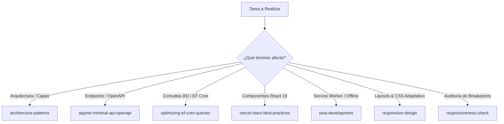

# Reglas Operativas para Asistentes de IA (AGENTS.md) - GymApp

Este proyecto se rige por **Spec-Driven Development (SDD)** y las normas vinculantes estipuladas en [CONSTITUTION.md](file:///c:/Users/pc/Desktop/Proyectos/GymApp/CONSTITUTION.md).
Cualquier agente de IA que opere en este repositorio DEBE seguir estas reglas de forma obligatoria e incondicional.

---

## 1. Reglas de Oro: Spec-First Estricto y Planificación con Skills
- **NUNCA** generes ni modifiques código C# o TypeScript para endpoints, DTOs o modelos sin verificar primero que el cambio esté especificado en [docs/specs/api-spec.yaml](file:///c:/Users/pc/Desktop/Proyectos/GymApp/docs/specs/api-spec.yaml).
- **TODO PLAN DE IMPLEMENTACIÓN O TAREA** propuesto al usuario (incluyendo artefactos de plan) DEBE incluir por diseño y de forma obligatoria la matriz de **Skills Rectoras** y especificar para cada fase la skill correspondiente y sus directivas técnicas vinculantes. Queda prohibido presentar un plan sin este desglose.
- **SEPARACIÓN ESTRICTA EN VERTICAL SLICES (VSA):** Todo endpoint Minimal API debe ser transporte HTTP puro (rutas, autorización, claims, filtro FluentValidation). Queda **estrictamente prohibido inyectar `DbContext` o incluir lógica de negocio, branching condicional o consultas LINQ dentro de la lambda del endpoint**. Toda lógica de orquestación, validación de pertenencia y persistencia debe residir en un `I{Feature}Handler` Scoped que retorne `Result<T>` agnóstico a HTTP, y las entidades deben proteger sus invariantes con métodos de fábrica.
- Toda respuesta de error en la API debe seguir el formato RFC 9457 `ProblemDetails`.
- Toda interacción de entrenamiento del alumno en la PWA debe soportar persistencia local en `IndexedDB` (`Dexie.js`) con claves de idempotencia UUIDv4.
- **TRAZABILIDAD Y GOBERNANZA DE ADRs:** Toda decisión arquitectónica de impacto estructural debe registrarse en `docs/adr/`. Los DTOs deben documentarse con comentarios XML (`/// 
`) para autodescripción en Scalar.

---

## 2. Activación Obligatoria de Skills por Tarea

Antes de redactar o modificar código en cualquier capa, DEBES consultar y seguir las pautas de la skill correspondiente ubicada en `.agents/skills/`:

### Tabla de Disparo de Skills:

1. **Al trabajar en Estructura, Capas o Límites de Módulos:**
   - **Skill:** [architecture-patterns](file:///c:/Users/pc/Desktop/Proyectos/GymApp/.agents/skills/architecture-patterns/SKILL.md)
   - **Objetivo:** Asegurar Clean Architecture, desacoplamiento de dependencias y organización limpia por Vertical Slices.

2. **Al crear o modificar Minimal APIs en .NET 10:**
   - **Skill:** [aspnet-minimal-api-openapi](file:///c:/Users/pc/Desktop/Proyectos/GymApp/.agents/skills/aspnet-minimal-api-openapi/SKILL.md)
   - **Objetivo:** Usar `TypedResults`, documentar con OpenAPI/Scalar, estructurar endpoints modulares y validar contratos.

3. **Al interactuar con Base de Datos o Entity Framework Core 10:**
   - **Skill:** [optimizing-ef-core-queries](file:///c:/Users/pc/Desktop/Proyectos/GymApp/.agents/skills/optimizing-ef-core-queries/SKILL.md)
   - **Objetivo:** Evitar consultas N+1, usar `.AsNoTracking()` en lecturas, seleccionar únicamente las columnas necesarias con proyecciones y definir índices adecuados.

4. **Al crear Componentes o Hooks de React 19:**
   - **Skill:** [vercel-react-best-practices](file:///c:/Users/pc/Desktop/Proyectos/GymApp/.agents/skills/vercel-react-best-practices/SKILL.md)
   - **Objetivo:** Minimizar renders innecesarios, componer componentes limpios, optimizar bundles y garantizar experiencia móvil fluida.

5. **Al trabajar en la PWA, Service Workers o Caché Offline:**
   - **Skill:** [pwa-development](file:///c:/Users/pc/Desktop/Proyectos/GymApp/.agents/skills/pwa-development/SKILL.md)
   - **Objetivo:** Configurar Workbox, Service Workers, soporte de instalación standalone y sincronización resiliente con IndexedDB.

6. **Al diseñar o refactorizar Layouts, CSS Móvil y Adaptabilidad:**
   - **Skill:** [responsive-design](file:///c:/Users/pc/Desktop/Proyectos/GymApp/.agents/skills/responsive-design/SKILL.md)
   - **Objetivo:** Implementar layouts mobile-first, tipografía fluida, container queries, unidades dinámicas `dvh`, evitar desbordamientos horizontales y garantizar touch targets de 44-48px.

7. **Al verificar, auditar y diagnosticar Breakpoints y Viewports:**
   - **Skill:** [responsiveness-check](file:///c:/Users/pc/Desktop/Proyectos/GymApp/.agents/skills/responsiveness-check/SKILL.md)
   - **Objetivo:** Auditar y validar sistemáticamente la interfaz a través de los anchos móviles (320px, 375px, 430px) y detectar solapamientos, cortes o colapsos de flexbox.

---

## 3. Límites Taxativos del Alcance (*Out of Scope*)
- **NO implementar** pasarelas de pago automáticas (MercadoPago, Stripe).
- **NO implementar** chats internos ni WebSockets (solo deeplinks directos a WhatsApp).
- **NO implementar** redes sociales, comentarios ni perfiles públicos entre alumnos.
