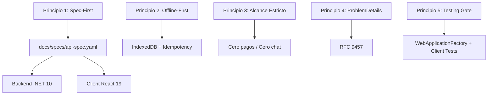

# CONSTITUCIÓN DEL PROYECTO: GYMAPP

**Versión:** 1.0.0  
**Estado:** Activa y Vinculante  
**Alcance:** Aplica a todos los desarrolladores humanos y asistentes de IA (Antigravity/LLMs) que contribuyan al repositorio.  
**Metodología Central:** Spec-Driven Development (SDD) & Clean Architecture Vertical Slices  

---

## 1. Declaración de Principios y Reglas de Oro (No Negociables)

Esta Constitución establece los límites técnicos, arquitectónicos y funcionales del proyecto GymApp. Cualquier pull request, commit o propuesta de código que viole estos artículos será rechazado automáticamente sin excepción.



---

## ARTÍCULO I: Gobernanza de Contratos y Spec-First Estricto

1. **Tolerancia Cero a Desvíos de Contrato:**  
   La única fuente de verdad para la API es [`docs/specs/api-spec.yaml`](file:///c:/Users/pc/Desktop/Proyectos/GymApp/docs/specs/api-spec.yaml).
2. **Secuencia de Desarrollo Obligatoria:**  
   Queda estrictamente prohibido escribir código C# (Minimal APIs, DTOs) o TypeScript (interfaces, servicios de cliente) sin que el endpoint, método, código de respuesta y payload hayan sido primero especificados, revisados y versionados en el archivo OpenAPI.
3. **Sincronización Automatizada:**  
   Los tipos de TypeScript en el cliente deben derivarse directamente de la especificación mediante herramientas automatizadas (`openapi-typescript`). No se permite la creación manual de interfaces duplicadas que entren en conflicto con el esquema.

---

## ARTÍCULO II: Límites Taxativos del Alcance (*Anti-Patterns* y *Out of Scope*)

Queda taxativamente **PROHIBIDO** diseñar, estructurar o codificar las siguientes funcionalidades:

1. **Pasarelas de Pago Automáticas:**  
   No se integrarán SDKs ni APIs de pago (MercadoPago, Stripe, PayPal, etc.). El modelo de suscripción es 100% administrativo y manual: el Trainer gestiona el indicador de cuota ("Al día", "Vencido", "Clases restantes") tras constatar transferencias bancarias directas.
2. **Chat Interno o Conexiones en Tiempo Real (WebSockets / SignalR):**  
   No se implementarán sockets ni mensajería interna. La comunicación alumno-entrenador se canaliza exclusivamente mediante deeplinks a la API oficial de WhatsApp (`https://wa.me/...`) con mensajes de contexto preformateados.
3. **Módulos de Red Social:**  
   No se permitirán muros públicos, fotos de perfiles compartidas, likes, comentarios ni interacción pública entre alumnos. La privacidad del entrenamiento es 1 a 1 (Trainer - Alumno).

---

## ARTÍCULO III: Estrategia Offline-First e Idempotencia en el Gimnasio

1. **Resiliencia Local:**  
   La vista activa de entrenamiento del alumno debe funcionar plenamente sin conexión a internet. Toda interacción (completar serie, cambiar peso/repeticiones reales, timer) debe persistirse de forma inmediata y síncrona en `IndexedDB` (`Dexie.js`).
2. **Idempotencia Obligatoria:**  
   Cada sesión iniciada en el cliente generará un `Idempotency-Key` (UUIDv4).
3. **Resolución de Sincronización (Client-Wins):**  
   Al recuperar señal, el cliente despachará el lote de sesiones pendientes a `POST /api/workouts/sync`.  
   - Si la clave de idempotencia no existe en PostgreSQL, se persiste la sesión completa y sus series (`CREATED`).
   - Si la clave ya existe, el backend responderá HTTP 200 con estado `ALREADY_EXISTS`, preservando la integridad sin duplicar datos ni arrojar error.

---

## ARTÍCULO IV: Estándares de Validación y Manejo de Errores

1. **Validación de Requests en .NET 10:**  
   Toda petición entrante que modifique estado debe ser validada mediante `FluentValidation` en el backend antes de alcanzar los handlers de negocio, alineándose con las restricciones documentadas en [`docs/specs/data-dictionary.md`](file:///c:/Users/pc/Desktop/Proyectos/GymApp/docs/specs/data-dictionary.md).
2. **Manejo Estándar de Errores (RFC 9457 / RFC 7807):**  
   Todos los errores de la API (validación, conflictos, no encontrados, no autorizados) se emitirán bajo el estándar `ProblemDetails` nativo de .NET 10, con la siguiente estructura canónica:
   ```json
   {
     "type": "https://tools.ietf.org/html/rfc9457",
     "title": "One or more validation errors occurred.",
     "status": 400,
     "detail": "Detailed explanation of the failure.",
     "errors": {
       "ActualWeightKg": ["El peso debe ser mayor a 0."]
     }
   }
   ```
   Queda prohibido devolver respuestas con envoltorios ad-hoc (como `{ success: false, msg: "error" }`).

---

---

## ARTÍCULO V: Separación Estricta de Responsabilidades en Vertical Slices (Backend .NET 10)

Para garantizar un diseño desacoplado, mantenible y testeable bajo Vertical Slice Architecture, todo slice backend DEBE adherirse a la siguiente segregación estricta de responsabilidades:

1. **Responsabilidad del Endpoint (Transporte HTTP Puro):**
   - El endpoint solo es responsable del enrutamiento HTTP, políticas de autorización/roles, extracción de claims (JWT), ejecución del filtro de `FluentValidation` y delegación inmediata de la solicitud al Handler.
   - **PROHIBICIÓN TAXATIVA:** Queda terminantemente prohibido inyectar `DbContext`, ejecutar queries LINQ o SQL, orquestar transacciones en base de datos o incluir lógica condicional de negocio (`if/else`) dentro de la lambda del endpoint.
   - **Tipado Estricto:** Toda respuesta debe emplear `TypedResults` con DTOs fuertemente tipados (`Results<Ok<TResponse>, ProblemHttpResult>`). Queda prohibido devolver tipos anónimos o `TypedResults.Ok<object>`.
   - **Manejo de Errores RFC 9457:** Los errores deben emitirse exclusivamente mediante `ProblemHttpResult` (`ProblemDetailsResults.NotFound(...)`, `BadRequest(...)`, etc.). Queda prohibido retornar strings planos (`NotFound("...")`).

2. **Responsabilidad del Handler (Capa de Aplicación y Casos de Uso):**
   - Cada slice debe implementar su propio Handler inyectable por interfaz (`I{Feature}Handler` y `{Feature}Handler`) registrado como servicio Scoped en el contenedor de dependencias (`builder.Services.AddScoped<I..., ...>()`), sin dependencias de librerías de mediación externas de terceros.
   - El Handler es el único responsable de coordinar operaciones sobre `GymAppDbContext`, validar pertenencia y existencia previa de datos (ej. verificar que los ejercicios pertenezcan al entrenador autenticado) y aplicar optimizaciones de EF Core (como `.ExecuteUpdateAsync` para operaciones masivas).
   - **Desacoplamiento de Transporte (Result Pattern):** El Handler debe retornar un tipo de resultado agnóstico al protocolo HTTP (`Result<T>`), permitiendo que el endpoint traduzca limpiamente el estado a respuestas HTTP (`TypedResults` o `ProblemHttpResult`) sin que el Handler importe tipos de `Microsoft.AspNetCore.Http`.

3. **Responsabilidad del Dominio (Entidades No Anémicas):**
   - Las entidades deben encapsular la creación de instancias complejas y la protección de sus invariantes mediante métodos estáticos de fábrica (ej. `RoutineTemplate.Create(...)`, `RoutineAssignment.CreateActive(...)`) y métodos de mutación controlada (ej. `routineDay.AddExercise(...)`, `assignment.Deactivate()`).
   - Queda prohibido dispersar inicializadores de objetos anémicos con setters públicos sin validación a lo largo de mappers o controladores.

4. **Alineación de Principios SOLID en Vertical Slices:**
   - **SRP:** Un Handler atiende una única intención de negocio; el Endpoint gestiona únicamente el transporte HTTP; los Mappers proyectan datos.
   - **OCP:** Se prohíbe modificar Handlers existentes para introducir casos de uso diferentes; toda nueva capacidad se incorpora mediante un nuevo Vertical Slice sin regresión.
   - **LSP:** Todos los Handlers retornan el monad canónico `Result<T>` y los endpoints respetan las firmas OpenAPI documentadas y errores RFC 9457 `ProblemHttpResult`.
   - **ISP:** Quedan prohibidas las mega-interfaces (`IStudentService`). Toda interfaz de caso de uso debe ser atómica (`I{Feature}Handler`) con una única firma: `Task<Result<T>> HandleAsync(...)`.
   - **DIP:** Los Endpoints inyectan abstracciones de Handlers (`I{Feature}Handler`) registradas en DI, y la capa de aplicación desconoce los frameworks de transporte HTTP (`Microsoft.AspNetCore.Http`).

---

## ARTÍCULO VI: Matriz Vinculante de Skills Especializadas y Estándares Técnicos

Para garantizar que el código cumpla con los estándares más exigentes de la industria, es obligatorio consultar y aplicar las directrices de las **skills instaladas en `.agents/skills/`** según la capa o tecnología que se esté desarrollando:

| Dominio / Capa | Skill Vinculante | Ubicación | Mandato No Negociable |
| :--- | :--- | :--- | :--- |
| **Arquitectura Global** | `architecture-patterns` | [architecture-patterns](file:///c:/Users/pc/Desktop/Proyectos/GymApp/.agents/skills/architecture-patterns/SKILL.md) | Desacoplamiento estricto, Clean Architecture y Vertical Slices con Handlers y Result pattern. |
| **Backend & Minimal APIs** | `aspnet-minimal-api-openapi` | [aspnet-minimal-api-openapi](file:///c:/Users/pc/Desktop/Proyectos/GymApp/.agents/skills/aspnet-minimal-api-openapi/SKILL.md) | Endpoints Minimal APIs en .NET 10 tipados con `TypedResults`, OpenAPI y Scalar. Transporte puro. |
| **Acceso a Datos & BD** | `optimizing-ef-core-queries` | [optimizing-ef-core-queries](file:///c:/Users/pc/Desktop/Proyectos/GymApp/.agents/skills/optimizing-ef-core-queries/SKILL.md) | Prohibición de N+1, uso estricto de `.AsNoTracking()` en lecturas, índices de cobertura y transacciones seguras. |
| **Frontend UI (React 19)** | `vercel-react-best-practices` | [vercel-react-best-practices](file:///c:/Users/pc/Desktop/Proyectos/GymApp/.agents/skills/vercel-react-best-practices/SKILL.md) | Renderizado óptimo, eliminación de renders innecesarios, bundle modular y reactividad limpia. |
| **PWA & Offline-First** | `pwa-development` | [pwa-development](file:///c:/Users/pc/Desktop/Proyectos/GymApp/.agents/skills/pwa-development/SKILL.md) | Service Workers con Workbox, estrategias de cache stale-while-revalidate y resiliencia sin conexión. |

1. **Backend (.NET 10):**  
   - Arquitectura Clean Architecture / Vertical Slices guiada por `architecture-patterns`.
   - Minimal APIs fuertemente tipadas utilizando extensiones OpenAPI/Scalar guiadas por `aspnet-minimal-api-openapi`.
   - EF Core 10: Consultas de lectura optimizadas con `.AsNoTracking()`, proyecciones directas (`.Select(...)`) e índices de acuerdo a `optimizing-ef-core-queries`.
2. **Frontend PWA (React 19 + TypeScript):**  
   - Cumplimiento estricto de las directrices de `vercel-react-best-practices`.
   - Soporte PWA para standalone mode, orientación portrait, safe-area-insets y Service Worker configurado según `pwa-development`.
   - Timers basados en `performance.now()` o Web Workers para evitar congelamiento de descansos cuando la pantalla se apague.

---

## ARTÍCULO VII: Estrategia de Testing Mínimo Obligatorio (Definition of Done)

Ningún Vertical Slice se considerará finalizado (*Done*) sin cumplir con la siguiente barrera de calidad:

1. **Backend:**  
   - Pruebas de integración de endpoints utilizando `WebApplicationFactory<Program>` que verifiquen el contrato HTTP, validaciones FluentValidation y el comportamiento de la base de datos de prueba.
2. **Frontend:**  
   - Pruebas unitarias/integración de la lógica de persistencia local en `IndexedDB` y del despachador de sincronización offline ante microcortes de red.

---

## ARTÍCULO VIII: Gobernanza Documental, Trazabilidad (ADRs) y Onboarding Canónico

Para garantizar la máxima transparencia, la trazabilidad histórica de las decisiones técnicas y un ingreso fluido de cualquier colaborador o asistente de IA al proyecto, se establecen las siguientes directivas obligatorias:

1. **Trazabilidad Inmutable mediante ADRs (`docs/adr/`):**
   - Toda decisión técnica y arquitectónica de alto impacto (elección de librerías, patrones de diseño, estrategias de persistencia, protocolos de sincronización offline o límites del alcance) DEBE formalizarse mediante un Architectural Decision Record en `docs/adr/` bajo la estructura canónica: *Contexto, Decisión Tomada, Alternativas Descartadas y Consecuencias*.
   - Queda estrictamente prohibido alterar o refactorizar decisiones estructurales del proyecto sin un ADR aprobado que justifique el cambio.

2. **Autodescripción de Contratos (XML Documentation + Scalar):**
   - El proyecto de API (.NET 10) debe compilar con `<GenerateDocumentationFile>true</GenerateDocumentationFile>` habilitado.
   - Todos los DTOs de entrada/salida y sus propiedades deben contener comentarios XML (`/// <summary>`) claros y representativos para que la UI interactiva de Scalar (`/scalar/v1`) sea 100% autodescriptiva sin requerir consultas a manuales externos desactualizados.

3. **Puerta de Entrada Canónica de Onboarding (`README.md`):**
   - El archivo `README.md` en la raíz del repositorio constituye la única fuente oficial de instrucciones para el arranque del entorno local.
   - Debe contener sin excepción el stack tecnológico, los prerrequisitos de versiones (.NET 10, Node.js 22+, Docker), la guía de arranque en 3 pasos (`docker compose`, `dotnet run`, `npm run dev`) y los comandos de verificación de suites de pruebas.

---

## ARTÍCULO IX: Separación de Responsabilidades, Ciclo de Vida y Ergonomía Mobile-First en Frontend (React 19 PWA)

Para garantizar un rendimiento móvil de élite y prevenir la degradación hacia *Fat Components*, todo desarrollo de frontend en React 19 DEBE adherirse a las siguientes normas vinculantes:

1. **Separación de Responsabilidades en Tres Capas Limpias:**
   - **Capa 1: UI Presentacional (Dumb Components):** Componentes puros que solo reciben props y emiten eventos (`onClick`, `onChange`). Queda taxativamente prohibido inyectar o importar directamente `Dexie` (`gymDb`), ejecutar llamadas `fetch`/HTTP o disparar timers dentro de componentes presentacionales.
   - **Capa 2: Orquestación de Casos de Uso (Custom Hooks):** Toda la lógica de negocio, transiciones de estado, effects y coordinación entre persistencia y UI debe encapsularse en Custom Hooks dedicados (`useActiveWorkout`, `useRestTimer`, `useOfflineSync`).
   - **Capa 3: Infraestructura y Persistencia (Agnóstica a React):** Módulos TypeScript puros (`gymDatabase.ts`, `apiClient.ts`) sin dependencias del ciclo de vida de React.

2. **Alineación de Principios SOLID en React 19:**
   - **SRP:** Un componente solo renderiza una parte de la UI; un hook solo orquesta un caso de uso; un servicio solo interactúa con I/O.
   - **OCP:** Extensión de interfaz mediante composición de componentes y slots (`children`), no mediante cadenas infinitas de condicionales `if/else`.
   - **LSP:** Contratos predecibles de componentes y hooks, asegurando que componentes derivados o mockeados respeten las firmas de props y eventos.
   - **ISP:** Props segregadas y mínimas. Queda prohibido pasar objetos de dominio masivos a componentes que solo necesitan una o dos propiedades primitivas.
   - **DIP:** Los componentes de presentación dependen de interfaces de props y de abstracciones expuestas por los hooks, nunca de clientes HTTP concretos o singletons de almacenamiento local.

3. **Ciclo de Vida y Aislamiento de Re-renders (Vercel React Best Practices):**
   - **Aislamiento del Rest Timer:** El segundero del temporizador de descanso (`secondsRemaining`) DEBE estar completamente encapsulado en su propio componente o modal hijo. Queda prohibido situar el estado del segundero en la raíz de la sesión de entrenamiento para evitar re-renderizar la lista de ejercicios cada segundo.
   - **Limpieza de Recursos (Cleanups):** Todo efecto con temporizadores (`setInterval`, `setTimeout`), suscripciones a eventos de red (`online`, `offline`) o Web Audio DEBE retornar una función de limpieza explícita para evitar fugas de memoria.
   - **Derivación de Estado:** Prohibido duplicar estados calculables en `useEffect`; todo cálculo debe derivarse en render o mediante `useMemo` solo para operaciones costosas.

4. **Ergonomía Mobile-First para Uso con Una Sola Mano (Gym Mode UX):**
   - **Zona del Pulgar (Thumb Zone):** Las acciones críticas y de alta frecuencia (confirmar serie, iniciar descanso, siguiente ejercicio, finalizar sesión) deben ubicarse ancladas en la zona inferior de la pantalla (Bottom Sheets, Bottom Action Bar).
   - **Hit Targets Táctiles Grandes:** Todo botón, selector o casilla de verificación táctil debe tener un tamaño mínimo de impacto de 48x48 píxeles para operar con manos cansadas o sudorosas en el gimnasio.
   - **Controles de Carga Ágiles:** Entradas numéricas con inputs grandes y botones de paso rápido (steppers `+2.5kg / -2.5kg`, `+1 rep / -1 rep`) para evitar escribir en teclados virtuales complejos durante el entreno.
   - **Feedback Háptico y Sonoro:** Confirmación de serie completada y fin de descanso mediante vibración (`navigator.vibrate`) y campana de audio sintetizada con Web Audio API.

---

## ARTÍCULO X: Modificación de la Constitución

Cualquier enmienda a este documento requerirá:
1. Justificación técnica documentada del cambio.
2. Aprobación explícita del Lead Software Architect.
3. Actualización correspondiente en `docs/architecture/SDD.md` y `docs/specs/api-spec.yaml`.

