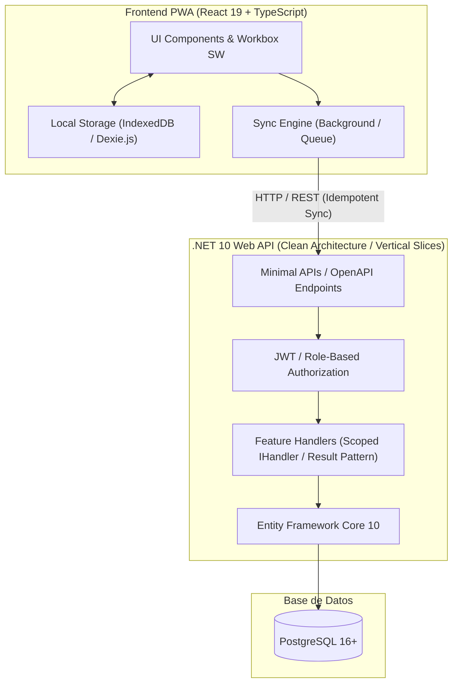
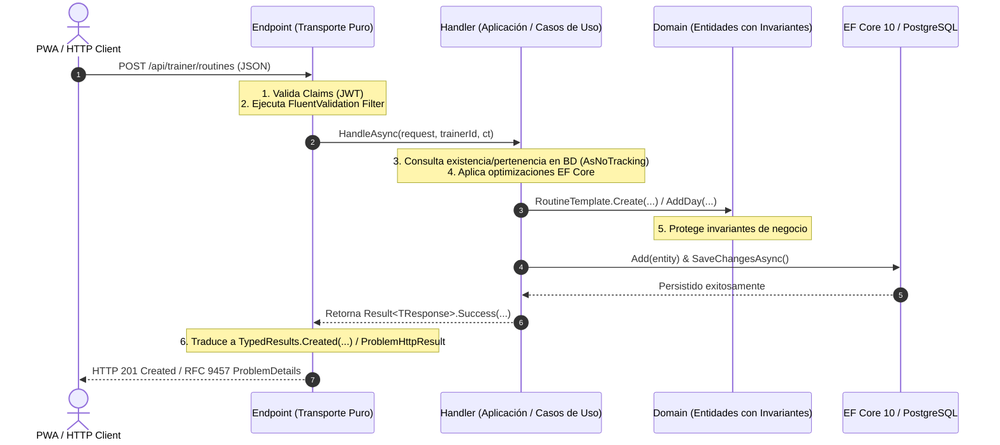
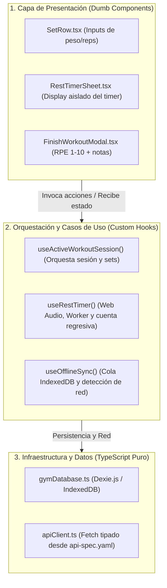

# Software Design Document (SDD) - GymApp (PWA para Personal Trainer y Alumnos)

**Version:** 1.0.0  
**Fecha:** Octubre 2026  
**Metodología:** Spec-Driven Development (SDD) & Clean Architecture Vertical Slices  
**Target:** .NET 10 Web API + PostgreSQL + React 19 PWA  

---

## 1. Introducción y Visión del Producto

GymApp es una Progressive Web App (PWA) de alto rendimiento orientada a dispositivos móviles, diseñada para digitalizar la interacción y el seguimiento de entrenamientos entre un **Personal Trainer (PT)** y sus **Alumnos** de clases personalizadas.

### 1.1 Principios de Diseño
1. **Offline-First Resilience:** La experiencia del gimnasio a menudo transcurre en sótanos o zonas sin señal celular. El alumno debe poder iniciar, registrar series y finalizar su entrenamiento sin depender de conectividad activa.
2. **Mobile-First UX con una sola mano:** Botones grandes, inputs táctiles optimizados, timer de descanso con feedback sonoro/haptic y un flujo sin fricción para registrar series.
3. **Spec-Driven Governance:** Todos los modelos y endpoints se derivan de especificaciones de contratos compartidos (OpenAPI 3.1 + Esquemas relacionales), asegurando consistencia estricta entre .NET 10 y React 19.
4. **Cero fricción administrativa:** Sin pasarela de pagos integrada; el estado de cuota y clases es gestionado manualmente por el PT. Enlace directo a WhatsApp vía deeplink para soporte y avisos.

---

## 2. Actores y Matriz de Permisos

| Rol | Alcance | Capacidades Clave |
| :--- | :--- | :--- |
| **TRAINER (Admin)** | Gestión de sus propios alumnos | - Alta y baja de alumnos.<br>- Actualización manual de cuota y packs de clases.<br>- CRUD de biblioteca de ejercicios con videos y tips.<br>- Creación de plantillas de rutinas (Día A, Día B) y asignación.<br>- Visualización de métricas históricas de alumnos (cargas, RPE, notas). |
| **STUDENT (Usuario)** | Vista personal de entrenamiento | - Consulta de rutina activa asignada.<br>- Ejecución de la sesión del día (checklist, timer, edición de peso/reps reales).<br>- Consulta inline del historial previo del ejercicio.<br>- Cierre con RPE y notas.<br>- Sincronización offline en segundo plano.<br>- Botón flotante a WhatsApp con mensaje contextual. |

---

## 3. Arquitectura del Sistema



### 3.1 Patrón Canónico de Vertical Slice (Segregación de Responsabilidades)

Para evitar la degradación arquitectónica hacia *Fat Endpoints* y garantizar la máxima testeabilidad y desacoplamiento, cada funcionalidad backend se estructura en tres capas delimitadas con responsabilidades estrictas:



#### Reglas Taxativas por Capa:
1. **Endpoint (Transporte HTTP Puro):**
   - **Alcance Único:** Mapeo de rutas Minimal API, metadata OpenAPI/Scalar, requerimiento de roles/políticas, extracción de claims de usuario (`ClaimsPrincipal`), validación automática (`.WithValidation<T>()`) y delegación directa al Handler inyectado.
   - **Prohibición:** CERO inyección de `GymAppDbContext`, CERO queries LINQ/SQL, CERO lógica condicional de negocio (`if/else`) sobre datos del dominio.
   - **Retorno:** Respuestas fuertemente tipadas mediante `TypedResults` (`Results<Created<TResponse>, ProblemHttpResult>`). Prohibido devolver tipos anónimos o `TypedResults.Ok<object>`. Errores exclusivamente mediante RFC 9457 `ProblemHttpResult`.
2. **Handler (Capa de Aplicación y Casos de Uso):**
   - **Alcance Único:** Define una interfaz `I{Feature}Handler` y su implementación `{Feature}Handler` registrada en DI como `Scoped`.
   - **Orquestación:** Es la única capa que inyecta `GymAppDbContext`. Valida pertenencia de registros (ej. que los alumnos o ejercicios pertenezcan al entrenador autenticado), ejecuta mutaciones masivas con `.ExecuteUpdateAsync(...)` y coordina transacciones.
   - **Agnóstico al Transporte:** Retorna `Result<T>` (`Success`, `NotFound`, `BadRequest`, `Forbidden`, etc.). Prohibido importar namespaces HTTP como `Microsoft.AspNetCore.Http` o `Results` dentro del Handler.
3. **Dominio (Entidades Ricas con Invariantes):**
   - **Alcance Único:** Las entidades de dominio encapsulan su instanciación y transiciones de estado a través de métodos de fábrica estáticos (ej. `RoutineTemplate.Create(...)`, `RoutineAssignment.CreateActive(...)`) y mutaciones controladas (ej. `routineDay.AddExercise(...)`, `assignment.Deactivate()`).
   - **Prohibición:** Se prohíbe el uso de entidades anémicas expuestas con inicializadores dispersos sin control de invariantes en capas externas.

### 3.2 Estructura del Repositorio
```
GymApp/
├── .vscode/
├── README.md                        <-- Guía Canónica de Onboarding y Quickstart
├── docker-compose.yml               <-- PostgreSQL 16 Alpine
├── docs/
│   ├── adr/                         <-- Architectural Decision Records (ADRs)
│   ├── architecture/
│   │   └── SDD.md                   <-- Este documento
│   └── specs/
│       ├── api-spec.yaml            <-- OpenAPI 3.1 Contract
│       └── data-dictionary.md       <-- Diccionario de datos y reglas
├── backend/                         <-- Solución .NET 10
│   ├── GymApp.slnx
│   ├── src/
│   │   └── GymApp.Api/              <-- Minimal APIs, VSA Handlers, EF Core 10, Scalar
│   └── tests/
│       └── GymApp.Api.Tests/        <-- Integration Tests con WebApplicationFactory
└── client/                          <-- React 19 + Vite PWA
    ├── public/                      <-- Manifest, iconos, audio de campana
    ├── src/
    │   ├── api/                     <-- Tipos y cliente generados desde OpenAPI
    │   ├── db/                      <-- Dexie.js (IndexedDB local cache)
    │   ├── components/              <-- WorkoutSession, Timer, Checklist
    │   ├── hooks/                   <-- useActiveWorkout, useOfflineSync
    │   └── pages/
```

### 3.3 Alineación de Principios SOLID en Vertical Slice Architecture

En GymApp, los principios **SOLID** se aplican a nivel de **Slices Verticales y Casos de Uso Autocontenidos**, erradicando los "God Services" horizontales y las abstracciones sobredimensionadas:

| Principio SOLID | Interpretación y Regla en Vertical Slices | Implementación Concreta en GymApp (.NET 10) |
| :--- | :--- | :--- |
| **S - Single Responsibility (SRP)** | **1 Slice = 1 Razón para cambiar.** Cada clase tiene un único rol bien definido: el Endpoint gestiona el transporte HTTP, el Handler atiende un caso de uso específico, el Mapper proyecta datos y la Entidad custodia sus invariantes de negocio. | `CreateRoutineTemplateHandler` solo cambia si varía la regla de creación de plantillas; no comparte lógica con la asignación ni con la consulta. |
| **O - Open/Closed (OCP)** | **Abierto a la extensión, cerrado a la modificación.** Nuevas capacidades del sistema se incorporan creando nuevos slices verticales completos, sin alterar ni poner en riesgo los archivos de los slices existentes. | Añadir una funcionalidad no modifica handlers en producción; simplemente se agrega `Features/.../NewFeatureHandler.cs` y su endpoint Minimal API. |
| **L - Liskov Substitution (LSP)** | **Contratos de retorno canónicos y predecibles.** Los tipos de resultado de la aplicación (`Result<T>`) y las respuestas HTTP (`TypedResults` con RFC 9457) mantienen semántica uniforme en todo el sistema. | Las pruebas de integración (`WebApplicationFactory`) sustituyen la persistencia o tokens sin alterar el comportamiento de los handlers ni la forma de los errores emitidos. |
| **I - Interface Segregation (ISP)** | **Interfaces atómicas enfocadas en un solo consumidor.** Quedan terminantemente prohibidas las mega-interfaces genéricas (`IStudentService`, `IRepository<T>`). Cada caso de uso define su propio contrato de firma única. | Cada Handler implementa una interfaz atómica dedicada: `I{Feature}Handler` con un único método: `Task<Result<TResponse>> HandleAsync(...)`. |
| **D - Dependency Inversion (DIP)** | **Inversión de dependencias y aislamiento de frameworks.** Los módulos de alto nivel dependen de abstracciones en DI, y los handlers de aplicación son agnósticos al protocolo de entrega. | 1. El Endpoint Minimal API inyecta `I{Feature}Handler`.<br>2. El Handler retorna `Result<T>` agnóstico a HTTP y desconoce `Microsoft.AspNetCore.Http`. |


### 3.4 Arquitectura de Componentes y Principios SOLID en Frontend (React 19)

Para prevenir la degradación hacia *Fat Components* (componentes monolíticos acoplados a I/O y temporizadores) y garantizar testeabilidad y reutilización, el frontend se estructura en tres capas desacopladas:



#### Aplicación Concreta de Principios SOLID en React 19:

| Principio SOLID | Interpretación en Frontend React 19 | Implementación Concreta en GymApp |
| :--- | :--- | :--- |
| **S - Single Responsibility (SRP)** | **1 Componente = 1 Función visual. 1 Hook = 1 Caso de uso.** Los componentes de UI solo renderizan y emiten eventos. Cero llamadas directas a `fetch` o `Dexie` en componentes de presentación. | `SetRow` solo renderiza el input de peso y reps y emite `onToggleCompleted`; no sabe nada de IndexedDB ni del timer de descanso. |
| **O - Open/Closed (OCP)** | **Composición sobre modificación.** Extensión mediante slots y composición (`children`), evitando cadenas de `if/else` dentro del JSX. | La vista de entrenamiento compone `<WorkoutHeader>`, `<ExerciseList>`, `<SetList>` y `<RestTimerSheet>` sin modificar sus implementaciones internas. |
| **L - Liskov Substitution (LSP)** | **Contratos predecibles de componentes y callbacks.** Las interfaces de props mantienen firmas uniformes y sin efectos colaterales ocultos. | Los componentes de inputs y botones respetan contratos estándar accesibles (`onChange`, `onClick`) y pueden ser sustituidos por mocks en tests de UI. |
| **I - Interface Segregation (ISP)** | **Props atómicas y segregadas.** Los componentes reciben únicamente los datos primitivos requeridos, no el objeto de sesión entero de 20 campos. | `SetRow` solo recibe `{ setNumber, targetReps, targetWeight, actualReps, actualWeight, completed }` y no todo el árbol del alumno. |
| **D - Dependency Inversion (DIP)** | **Desacoplamiento de I/O.** La UI consume abstracciones provistas por hooks; nunca importa singletons de base de datos (`gymDb`) directamente. | El componente de sesión depende del hook `useActiveWorkoutSession()`, permitiendo probar la UI con datos en memoria o mocks sin tocar IndexedDB. |

---

### 3.5 Ergonomía Mobile-First: One-Handed Gym Mode & Ciclo de Vida de Componentes

El entrenamiento en sala de pesas impone condiciones físicas adversas: manos sudorosas, fatiga muscular, uso del teléfono con una sola mano y pantallas que pueden bloquearse. La arquitectura de interfaz se rige por las siguientes pautas:

#### 1. Ergonomía para Uso con Una Sola Mano (Thumb Zone)
- **Zona del Pulgar:** Todas las interacciones críticas de alta frecuencia (confirmar serie, iniciar descanso, saltar ejercicio, finalizar sesión) se ubican ancladas en el tercio inferior de la pantalla (Bottom Sheets y Bottom Sticky Bars).
- **Hit Targets Mínimos de 48x48px:** Toda área táctil (checkboxes de series, botones de steppers) mide como mínimo 48x48 píxeles para prevenir toques erróneos.
- **Steppers de Carga Rápida:** Botones de paso ágil (`+2.5 kg / -2.5 kg`, `+1 rep / -1 rep`) y teclado numérico nativo (`inputMode="decimal"`), evitando desplegar teclados virtuales alfanuméricos completos que ocultan la pantalla.
- **Feedback Háptico y Sonoro:** Confirmación de serie completada mediante vibración corta (`navigator.vibrate(50)`) y aviso sonoro de fin de descanso sintetizado con Web Audio API.

#### 2. Ciclo de Vida y Performance (Alineación Vercel React Best Practices)
- **Aislamiento Estricto del Rest Timer:** El estado del segundero (`secondsRemaining`) se aísla en el componente `<RestTimerSheet />`. Queda prohibido situar el estado del segundero en la raíz del componente `<WorkoutSession />`, evitando que cada segundo re-renderice toda la lista de ejercicios (`rerender-split-combined-hooks`).
- **Limpieza Rigurosa de Efectos (Cleanups):** Todo efecto que configure `setInterval`, `setTimeout`, Web Audio `AudioContext` o listeners globales (`window.addEventListener('online')`) debe retornar su función de desuscripción/limpieza para evitar fugas de memoria (`client-event-listeners`).
- **Cálculo Derivado en Render:** Queda prohibido sincronizar estado derivado mediante `useEffect` (ej. porcentaje de completitud de la rutina). Toda métrica se deriva en tiempo de render o se optimiza con `useMemo` solo para estructuras pesadas (`rerender-derived-state-no-effect`).

---

## 4. Especificación del Modelo de Datos (EF Core 10 & PostgreSQL)

### 4.1 Entidades Principales
- **User:** Credenciales, datos de contacto, rol (`Trainer`, `Student`).
- **StudentProfile:** Extensión de `User` con pertenencia al `Trainer`, notas médicas, objetivos, estado de suscripción (`Active`, `Expired`, `Pending`) y contador de clases restantes.
- **Exercise:** Biblioteca de ejercicios con grupo muscular, patrón de movimiento, link de video y tips de ejecución.
- **RoutineTemplate:** Nombre de la rutina (ej. "Hipertrofia 4 días").
- **RoutineDay:** Días flexibles ("Día A: Pierna + Glúteos", "Día B: Torso", etc.).
- **RoutineExercise:** Ejercicio configurado para el día (series sugeridas, rango de reps, peso sugerido, descanso en segundos).
- **RoutineAssignment:** Asignación de la plantilla al alumno activo.
- **WorkoutSession:** Instancia de entrenamiento ejecutada por el alumno (fecha de inicio, fin, RPE 1-10, notas, idempotency key).
- **WorkoutLog:** Registro serie por serie (nro de serie, reps reales, peso real, completada).

---

## 5. Estrategia Offline-First y Protocolo de Sincronización

### 5.1 Flujo de Trabajo en el Gimnasio
1. **Pre-carga (Cache):** Al tener conectividad (ej. en casa o al entrar al gym), la PWA descarga la rutina activa del alumno y el último historial registrado para cada ejercicio en IndexedDB (`Dexie.js`).
2. **Ejecución Offline:**
   - Cada serie marcada como `completed` actualiza el estado local en IndexedDB inmediatamente.
   - El timer de descanso se ejecuta con Web Workers / `performance.now()` para no suspenderse en segundo plano.
3. **Cierre de Sesión:**
   - El alumno selecciona su RPE (1 a 10) e ingresa notas si las hubo.
   - La sesión se sella con un `Idempotency-Key` (UUIDv4 generado en el cliente) y se encola en la tabla local `PendingSyncSessions`.
4. **Sincronización:**
   - La PWA escucha eventos `online` y el evento `sync` del Service Worker.
   - Al detectar red, envía un `POST /api/workouts/sync` con el lote de sesiones pendientes.
   - El backend en .NET 10 verifica la `Idempotency-Key` en PostgreSQL para garantizar que si la petición se reintenta por microcortes, no se dupliquen registros.

---

## 6. Endpoints Clave y Contratos de API (.NET 10)

| Método | Endpoint | Rol | Descripción |
| :--- | :--- | :--- | :--- |
| `POST` | `/api/auth/login` | Público | Autenticación y emisión de JWT + Refresh Token. |
| `GET` | `/api/students/me/routine` | Student | Obtiene la rutina asignada activa con sesiones (Día A, Día B). |
| `GET` | `/api/exercises/{id}/history` | Student | Obtiene el historial previo de peso/reps del alumno para ese ejercicio. |
| `POST` | `/api/workouts/sync` | Student | Recepción de sesión finalizada con `Idempotency-Key` y logs de series. |
| `GET` | `/api/trainer/students` | Trainer | Listado de alumnos con estado de suscripción y clases restantes. |
| `POST` | `/api/trainer/exercises` | Trainer | Alta de ejercicio con tips y video. |
| `POST` | `/api/trainer/routines` | Trainer | Creación de plantilla con sus días y series sugeridas. |
| `POST` | `/api/trainer/routines/assign` | Trainer | Asignación de plantilla a un alumno. |

---

## 7. Hitos del Ciclo SDD
- [x] Elaboración del documento SDD inicial ([docs/architecture/SDD.md](file:///c:/Users/pc/Desktop/Proyectos/GymApp/docs/architecture/SDD.md)).
- [x] Creación de la especificación OpenAPI 3.1 ([docs/specs/api-spec.yaml](file:///c:/Users/pc/Desktop/Proyectos/GymApp/docs/specs/api-spec.yaml)).
- [x] Definición del Diccionario de Datos ([docs/specs/data-dictionary.md](file:///c:/Users/pc/Desktop/Proyectos/GymApp/docs/specs/data-dictionary.md)).
- [x] Redacción de la Constitución rectora ([CONSTITUTION.md](file:///c:/Users/pc/Desktop/Proyectos/GymApp/CONSTITUTION.md)).
- [x] Instalación e integración de Skills en [.agents/skills/](file:///c:/Users/pc/Desktop/Proyectos/GymApp/.agents/skills) y [AGENTS.md](file:///c:/Users/pc/Desktop/Proyectos/GymApp/AGENTS.md).
- [x] Inicialización de la solución backend (.NET 10 Web API con VSA, EF Core 10, Scalar y ProblemDetails).
- [x] Inicialización del cliente PWA (React 19 + TypeScript + Vite + PWA Plugin + Dexie.js + OpenAPI types).
- [x] Implementación del Componente Core de Sesión Activa con Timer e IndexedDB en la PWA.
- [x] Hub de Entrenador en PWA (Gestión de Rutinas, Plantillas, Días A/B/C/D y Asignación a Alumnos).
- [x] Optimización de Responsividad Universal Mobile en PWA (Alineación con responsive-design y responsiveness-check: 320px a 430px+).

---

## 8. Ecosistema de Skills y Gobernanza Técnica

Para mantener la máxima disciplina arquitectónica bajo el paradigma Spec-Driven Development, todo desarrollo se audita y guía a través de las siguientes skills especializadas instaladas en el repositorio:

| Capa / Tarea | Skill Asociada | Rol Arquitectónico en SDD |
| :--- | :--- | :--- |
| **Arquitectura de Software** | [`architecture-patterns`](file:///c:/Users/pc/Desktop/Proyectos/GymApp/.agents/skills/architecture-patterns/SKILL.md) | Asegura la separación estricta en Clean Architecture / Vertical Slices, previniendo acoplamiento indebido entre capas. |
| **Backend & Minimal APIs** | [`aspnet-minimal-api-openapi`](file:///c:/Users/pc/Desktop/Proyectos/GymApp/.agents/skills/aspnet-minimal-api-openapi/SKILL.md) | Estandariza la implementación de endpoints en .NET 10 con `TypedResults` y coherencia frente a `api-spec.yaml`. |
| **Persistencia EF Core 10** | [`optimizing-ef-core-queries`](file:///c:/Users/pc/Desktop/Proyectos/GymApp/.agents/skills/optimizing-ef-core-queries/SKILL.md) | Optimiza queries LINQ en PostgreSQL, previene problemas N+1, y asegura `.AsNoTracking()` e índices de cobertura. |
| **Frontend UI (React 19)** | [`vercel-react-best-practices`](file:///c:/Users/pc/Desktop/Proyectos/GymApp/.agents/skills/vercel-react-best-practices/SKILL.md) | Garantiza patrones óptimos de rendimiento en React, eliminando re-renders y optimizando la carga en móviles. |
| **PWA & Offline Gym Mode** | [`pwa-development`](file:///c:/Users/pc/Desktop/Proyectos/GymApp/.agents/skills/pwa-development/SKILL.md) | Rige la configuración de Workbox, Service Workers, instalación en móviles y persistencia local en `IndexedDB`. |
| **Layouts & CSS Adaptativo** | [`responsive-design`](file:///c:/Users/pc/Desktop/Proyectos/GymApp/.agents/skills/responsive-design/SKILL.md) | Implementa layouts mobile-first, tipografía fluida, container queries, unidades dinámicas `100dvh`, prevención de desbordamientos y touch targets ergonómicos de 44-48px. |
| **Auditoría de Breakpoints** | [`responsiveness-check`](file:///c:/Users/pc/Desktop/Proyectos/GymApp/.agents/skills/responsiveness-check/SKILL.md) | Audita sistemáticamente la interfaz a través del espectro de pantallas móviles (320px, 375px, 430px) y detecta solapamientos o colapsos de flexbox. |

---

## 9. Estrategia de Documentación Viva y Gobernanza Arquitectónica

Para asegurar la trazabilidad histórica, la autodescripción de contratos en tiempo de ejecución y una incorporación sin fricción de nuevos colaboradores, GymApp formaliza los siguientes tres pilares documentales:

### 9.1 Architectural Decision Records (ADRs) en `docs/adr/`
Toda decisión técnica fundamental de diseño y arquitectura debe registrarse de manera cronológica e inmutable en `docs/adr/` bajo la plantilla estándar (Contexto, Decisión Tomada, Alternativas Descartadas y Consecuencias):
- **ADR-0001:** `0001-vertical-slice-native-handlers.md` — Adopción de Vertical Slice Architecture con Handlers Scoped nativos por interfaz (`I{Feature}Handler`) y `Result<T>` en lugar de MediatR/Wolverine.
- **ADR-0002:** `0002-offline-first-idempotency-dexie.md` — Resiliencia Offline-First con persistencia inmediata en IndexedDB (`Dexie.js`) y sincronización por lotes idempotente (UUIDv4 `IdempotencyKey`) en lugar de WebSockets.
- **ADR-0003:** `0003-static-linq-mappers.md` — Estandarización de mapeos mediante métodos de extensión estáticos y expresiones LINQ reusables (`Expression<Func<TEntity, TDto>>`) en lugar de AutoMapper con reflection.
- **ADR-0004:** `0004-whatsapp-deeplinks.md` — Canalización exclusiva de la comunicación Alumno-Entrenador mediante deeplinks a WhatsApp (`https://wa.me/...`) en lugar de chat embebido.

### 9.2 Autodescripción de API con XML Documentation y Scalar
1. **Generación de XML Docs en .NET 10:** Habilitación de `<GenerateDocumentationFile>true</GenerateDocumentationFile>` en `GymApp.Api.csproj` (con supresión de advertencias `CS1591` para código generado o no documentado).
2. **Documentación de DTOs y Parámetros:** Todos los DTOs de entrada y salida, así como propiedades críticas, incorporan comentarios `/// <summary>` y `/// <example>`.
3. **Integración con OpenAPI y Scalar:** La interfaz de documentación viva de Scalar (`/scalar/v1`) en desarrollo ingiere automáticamente los resúmenes XML, mostrando a desarrolladores y clientes descripciones ricas de cada campo sin depender de documentación externa desactualizada.

### 9.3 Guía Canónica de Onboarding y Quickstart (`README.md`)
El archivo `README.md` en la raíz del repositorio actúa como la puerta de entrada oficial del proyecto:
- **Stack Tecnológico:** .NET 10 Web API, PostgreSQL 16 Alpine, React 19, TypeScript, Vite, PWA, Tailwind/Vanilla CSS.
- **Prerrequisitos:** Versiones mínimas requeridas del SDK de .NET 10, Node.js 22+ y Docker.
- **Guía de Arranque en 3 Pasos:**
  1. Base de datos: `docker compose up -d`.
  2. Backend: `dotnet run --project backend/src/GymApp.Api`.
  3. Frontend: `npm run dev` (en `client/`).
- **Comandos de Verificación:** Ejecución de pruebas automatizadas (`dotnet test`) y validación de TypeScript (`npm run build`).
